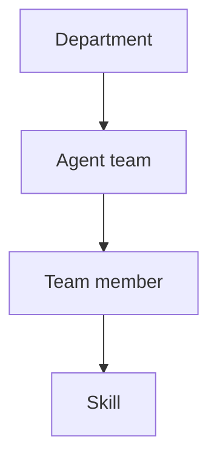
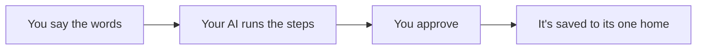

# Your Marketing Department

This is your company, built as files instead of headcount. Open your AI (Claude Code, Codex, Gemini CLI, Cursor or Grok) in this folder, talk to it like someone new on your team, and it reads and fills in these files as you go through the classroom.

## Start here

1. Open your AI in this folder: Claude Code, Codex, Gemini CLI, Cursor or Grok Build all work (the Command Center's Settings → AI Agents shows how for each).
2. Say "set up my code base." Your Dev Team (the one team that ships in your folder) connects GitHub, your keys and your hosting. From then on, say "save my work" whenever something changed.
3. Open `dashboard/index.html` in your browser to see your whole company: your agent teams, and your content on every platform as those teams arrive.
4. When you want to approve and edit posts from there, run `python3 tools/serve.py` (Windows: `py tools/serve.py`) and open the link it prints.

Works on Mac, Windows and Linux. On Windows, your AI may give you one command to install Python once (two minutes), because that's what keeps your skills and your Command Center in sync. On a Mac it's already there.

If you're an AI reading this, read `AGENTS.md` next. It says which files each job reads; nothing else needs reading up front.

## The folder map

```
business.md              what you sell, who you serve, the shared brain
brand/                    your voice, your look, your offer, who you serve
knowledge/                what your department learns: audit, competitors, swipes, reports
departments/              the company itself
  marketing/
  sales/
  it-systems/
  operations/
    <team>/team.md            a team: its members and its workflows
      <team-member>/<name>.md  a team member: its job, status, memory
        skills/<skill>/        one thing that team member knows how to do
routines/                 work that runs on a schedule
dashboard/index.html  the picture of all of it (python3 tools/serve.py turns editing on)
AGENTS.md                 the rules every AI follows in this repo (CLAUDE.md, GEMINI.md and .cursor/rules point here)
docs/REFERENCE.md         the long reference AGENTS.md points to: every home, the file formats, the Command Center
CHANGELOG.md              what's new since your copy was made
```

## Your teams

Your folder starts as a skeleton with one team in it, the **Dev Team** (`departments/it-systems/dev-team/`). It's the plumbing every other team needs: it saves your work to GitHub, keeps your keys in `.env`, connects your tools and ships your pages. Summon it with `/dev-team`, or just say what you want ("save my work", "set up my code base", "ship my landing page").

Every other team comes from the classroom. At the bottom of each lesson is a skill doc you give your AI, and that doc builds the team in `departments/` from your own answers. It shows up as a command and in the Command Center as soon as it's built. Marketing, Sales and Operations start empty, waiting for their lessons.

Once a team is built, type its command to summon it, say one of its workflows out loud, or run one skill on its own. In Claude Code, Gemini CLI, Cursor and Grok Build commands start with a slash (`/dev-team`, `/save-work`). In Codex they start with a dollar sign (`$dev-team`), or pick them from the `/skills` menu.

When the Strategy Team's lesson builds your **Company Strategist** (`/company-strategist`, or "talk to my company strategist"), it becomes your front door: it reads which teams you have and hands each ask to the one that owns it.

## How the company is built



## How a workflow runs



## Where everything goes

Every piece of information has exactly one home: your audit, your voice, your offer, competitors, reports, finished work, all of it. The full list is in `docs/REFERENCE.md` under "Where everything goes." Never make a second copy somewhere else, because copies drift.

## Staying up to date

This repo doesn't update itself, on purpose. `git pull` can't tell your own answers from the template's, so nothing here pulls or merges behind your back. `CHANGELOG.md` and `VERSION` show what's shipped since your copy was made. When something looks useful, say to your AI, "update my department to the newest version," and it fetches that piece and places it, never touching what you already wrote in `business.md` or `brand/`.

## The honest fine print

This template teaches a way of working. It doesn't run your business for you, and it can't guarantee anything about your accounts, your keys, your platforms, or your results. You own those. The security habits built in here (the env file, the sweeps, the checks) lower risk; nothing removes it. When something involves money, passwords, or other people's data, slow down and check it yourself.
