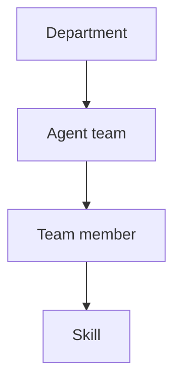
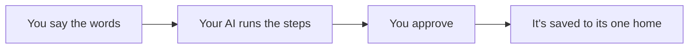

# Your Marketing Department

This is your company, built as files instead of headcount. Open your AI (Claude Code, Codex, Gemini CLI, Cursor or Grok) in this folder, talk to it like someone new on your team, and it reads and fills in these files as you go through the classroom.

## Start here

1. Open your AI in this folder: Claude Code, Codex, Gemini CLI, Cursor or Grok Build all work (the Command Center's Settings → AI Agents shows how for each).
2. Say "show me around." The Example Team shows you what's in your department and the full teams waiting in the team library. The classroom adds them one at a time: "add the website team".
3. Open `command-center/index.html` in your browser to see your whole company: your agent teams, and your content on every platform.
4. When you want to approve and edit posts from there, run `python3 tools/serve.py` (Windows: `py tools/serve.py`) and open the link it prints.

Works on Mac, Windows and Linux. On Windows, your AI may ask to install Python once (one command, two minutes), because that's what keeps your skills and your Command Center in sync. On a Mac it's already there.

If you're an AI reading this, read `AGENTS.md` next, then `business.md` and everything in `brand/`, before doing anything else. That's the rule every team follows.

## The folder map

```
business.md              what you sell, who you serve, the shared brain
brand/                    your voice, your look, your offer, who you serve
knowledge/                what your department learns: audit, competitors, swipes, reports
departments/              the company itself
  marketing/
  sales/
  it-systems/
  operations/
    <team>/team.md            a team: its members and its workflows
      <team-member>/<name>.md  a team member: its job, status, memory
        skills/<skill>/        one thing that team member knows how to do
routines/                 work that runs on a schedule
command-center/index.html  the picture of all of it (python3 tools/serve.py turns editing on)
AGENTS.md                 the rules every AI follows in this repo (CLAUDE.md, GEMINI.md and .cursor/rules point here)
CHANGELOG.md              what's new since your copy was made
```

## Your teams

Your department starts with one demo, the **Example Team**, so you can see how a team is built. Every full team waits in the team library (`library/teams/`) until the classroom gets to it. Say "add the website team" to your AI (or run `python3 tools/add_team.py website-team`), and the whole team, every team member, skill and workflow, lands in `departments/` and shows up in the Command Center. `python3 tools/add_team.py` on its own lists them all.

Once a team is added, type its command to summon it, say one of its workflows out loud (like "build my landing page"), or run one skill on its own. In Claude Code, Gemini CLI, Cursor and Grok Build commands start with a slash (`/website-team`, `/build-a-page`). In Codex they start with a dollar sign (`$website-team`), or pick them from the `/skills` menu.

Don't know which team does what? Add the Strategy Team and talk to your **Company Strategist** (`/company-strategist`, or just say "talk to my company strategist"). It reads which teams you have and hands each ask to the one that owns it.

| Department | Team | Add it with | In the library |
|---|---|---|---|
| Marketing | Content Team | "add the content team" | Ready |
| Marketing | Editing Team | "add the editing team" | Ready |
| Marketing | Website Team | "add the website team" | Ready |
| Marketing | Follow-Up Team | "add the follow-up team" | Ready |
| Marketing | Ads Team | "add the ads team" | Ready |
| Marketing | Research Team | "add the research team" | Ready |
| Marketing | Newsletter Team | "add the newsletter team" | Not ready yet |
| Sales | Sales Team | "add the sales team" | Ready |
| IT / Systems | Dev Team | "add the dev team" | Ready (its Payments Agent isn't yet) |
| Operations | Strategy Team | "add the strategy team" | Not ready yet |

## How the company is built



## How a workflow runs



## Where everything goes

Every piece of information has exactly one home: your audit, your voice, your offer, competitors, reports, finished work, all of it. The full list is in `AGENTS.md` under "Where everything goes." Never make a second copy somewhere else, because copies drift.

## Staying up to date

This repo doesn't update itself, on purpose. `git pull` can't tell your own answers from the template's, so nothing here pulls or merges behind your back. `CHANGELOG.md` and `VERSION` show what's shipped since your copy was made. When something looks useful, say to your AI, "update my department to version 3," and it fetches that piece and places it, never touching what you already wrote in `business.md` or `brand/`.

## The honest fine print

This template teaches a way of working. It doesn't run your business for you, and it can't guarantee anything about your accounts, your keys, your platforms, or your results. You own those. The security habits built in here (the env file, the sweeps, the checks) lower risk; nothing removes it. When something involves money, passwords, or other people's data, slow down and check it yourself.
