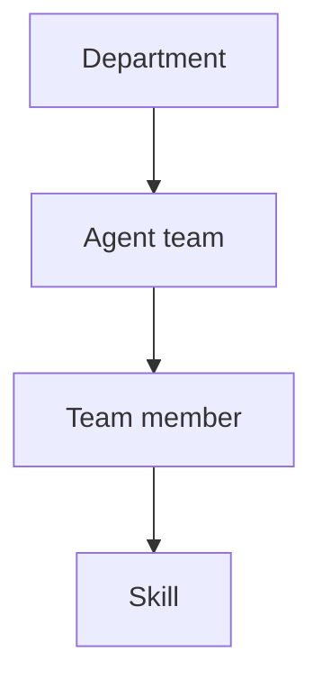
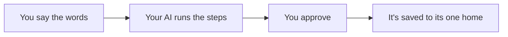

# Your Marketing Department

This is your company, built as files instead of headcount. Open Claude Code or Codex in this folder, talk to it like someone new on your team, and it reads and fills in these files as you go through the classroom.

## Start here

1. Open Claude Code or Codex in this folder.
2. Say "brain dump my business."
3. Open `command-center/index.html` in your browser to see your whole company.

If you're an AI reading this, read `AGENTS.md` next, then `business.md` and everything in `brand/`, before doing anything else. That's the rule every team follows.

## The folder map

```
business.md              what you sell, who you serve, the shared brain
brand/                    your voice, your look, your offer, who you serve
knowledge/                what your department learns: audit, competitors, swipes, reports
departments/              the company itself
  marketing/
  sales/
  it-systems/
  operations/
    <team>/team.md            a team: its members and its workflows
      <team-member>/<name>.md  a team member: its job, status, memory
        skills/<skill>/        one thing that team member knows how to do
routines/                 work that runs on a schedule
command-center/index.html  the picture of all of it
AGENTS.md                 the rules every AI follows in this repo
CHANGELOG.md              what's new since your copy was made
```

## Your teams

Type a team's command to summon it, say one of its workflows out loud (like "build my landing page"), or run one skill on its own. In Claude Code commands start with a slash (`/content-team`, `/draft-post`). In Codex they start with a dollar sign (`$content-team`, `$draft-post`), or pick them from the `/skills` menu. The classroom tells you which one each lesson uses.

**Ready** means the team already knows its job and just needs your accounts connected. **Waiting** means it's set up by a classroom lesson before you use it.

| Department | Team | Command | Status |
|---|---|---|---|
| Marketing | Content Team | `/content-team` | Waiting |
| Marketing | Website Team | `/website-team` | Ready |
| Marketing | Research Team | `/research-team` | Waiting |
| Marketing | Newsletter Team | `/newsletter-team` | Waiting |
| Marketing | Follow-Up Team | `/follow-up-team` | Waiting |
| Marketing | Ads Team | `/ads-team` | Waiting |
| Sales | Sales Team | `/sales-team` | Waiting |
| IT / Systems | Dev Team | `/dev-team` | Ready |
| Operations | Strategy Team | `/strategy-team` | Waiting |

## How the company is built



## How a workflow runs



## Where everything goes

Every piece of information has exactly one home: your audit, your voice, your offer, competitors, reports, finished work, all of it. The full list is in `AGENTS.md` under "Where everything goes." Never make a second copy somewhere else, because copies drift.

## Staying up to date

This repo doesn't update itself, on purpose. `git pull` can't tell your own answers from the template's, so nothing here pulls or merges behind your back. `CHANGELOG.md` and `VERSION` show what's shipped since your copy was made. When something looks useful, say to your AI, "update my department to version 3," and it fetches that piece and places it, never touching what you already wrote in `business.md` or `brand/`.

## The honest fine print

This template teaches a way of working. It doesn't run your business for you, and it can't guarantee anything about your accounts, your keys, your platforms, or your results. You own those. The security habits built in here (the env file, the sweeps, the checks) lower risk; nothing removes it. When something involves money, passwords, or other people's data, slow down and check it yourself.
